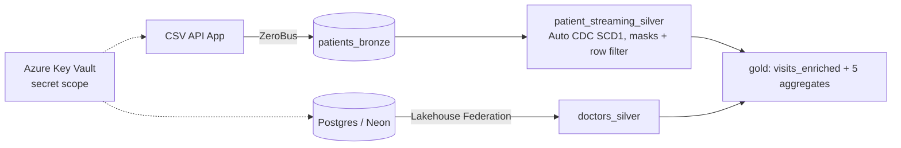

# hospital_emergency_databricks

Medallion platform for hospital ER visits on Databricks (Azure), deployed with Asset Bundles and GitHub Actions.

- **Streaming:** patient rows are served by a Databricks App (`csv-api-app_hospital/`) and sent to bronze with ZeroBus.
- **Batch:** doctors are read from Postgres via Lakehouse Federation (full table read on every pipeline update).
- **Pipeline:** Lakeflow declarative pipeline bronze → silver (Auto CDC, expectations) → gold.
- **Governance:** Unity Catalog, column masks + row filter on silver, secrets from an Azure Key Vault-backed scope.

## Architecture



Job `hospital_ingest_and_refresh`: `external_table_connection` + `zerobus_patients` + `governance` (parallel) → `run_pipeline`.

## Layout

| Path | Role |
| --- | --- |
| `databricks.yml` | Asset Bundle: targets `dev` / `prod` |
| `resources/` | job, pipeline, app, schemas + volumes |
| `hospital_ingestion_pipeline/transformations/` | Lakeflow files; pure logic in `src/` (unit tested) |
| `hospital_ingestion_pipeline/tests/` | pytest unit tests |
| `ZEROBUS_patients_ingest.py` | ZeroBus load into `{catalog}.hospital_bronze.patients_bronze` |
| `EXTERNAL_TABLE_CONNECTION.py` | Postgres connection + foreign catalog `hospital_db` |
| `GOVERNANCE.py` | creates mask / row-filter functions used by silver |
| `csv-api-app_hospital/` | Databricks App that streams CSV rows |
| `.github/workflows/deploy.yml` | tests + bundle validate + deploy |
| `docs/writeup.md` | design decisions, trade-offs, AI-assisted development |

## CI/CD

One workflow, `.github/workflows/deploy.yml`:

| Trigger | What runs |
| --- | --- |
| Pull request to `main` | pytest, then `bundle validate -t dev` |
| Push to `main` | pytest, then `bundle deploy -t dev` |
| Manual run, `target_env = prod` | pytest, then (after Environment approval) `bundle validate` + `bundle deploy -t prod` |

PROD is only changed by this workflow. Deploy does not start the job; run `hospital_ingest_and_refresh` afterwards (UI, or `databricks bundle run hospital_ingest_and_refresh -t <target>`).

### GitHub setup

Create Environments `dev` and `prod` (on `prod` enable **Required reviewers**). Secrets per environment, with suffix `_DEV` / `_PROD` as used in the workflow:

`DATABRICKS_HOST_*`, `DATABRICKS_TOKEN_*`, `ZEROBUS_WORKSPACE_ID_*`, `CATALOG_NAME_*`, `CSV_API_APP_NAME_*`, `ZEROBUS_REGION_*`

## Governance

- Column masks (`patient_id`, `first_initial`, `last_name`): shown only to group `hospital_admin`, others see `***`.
- Row filter on `department_referral`: visible to `hospital_admin` or group `dept_<department>` (e.g. `dept_orthopedics`).
- The pipeline's run-as principal must be in `hospital_admin`.
- Gold tables contain no patient identifiers.

## One-time setup in each workspace (not done by the bundle)

1. Create an **Azure Key Vault-backed** secret scope named `scope_blech` with keys: `postgresHost-blech`, `postgresUser-blech`, `postgresPassword-blech`, `sp-databricks-adls-appid`, `sp-databricks-adls-appkey`.
2. Create the UC catalog (`dbr_dev` / `dbr_prod`) and the account groups `hospital_admin`, `dept_*`.

## Local tests

```bash
pip install "pyspark>=4.0,<4.1" pytest
python -m pytest -v
```
