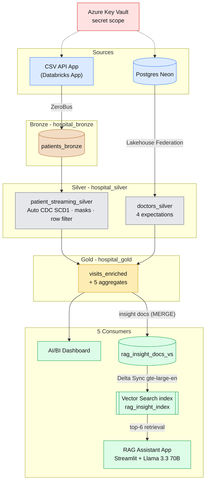

# 🏥 MedFlow Lakehouse

End-to-end **medallion data platform for hospital emergency-room visits** on Databricks (Azure), deployed to DEV and PROD with Databricks Asset Bundles and GitHub Actions.

## Highlights

- **Streaming ingestion:** patient rows are served by a Databricks App (`csv-api-app_hospital/`) and sent to bronze with **ZeroBus**.
- **Batch ingestion:** doctors are read from Postgres (Neon) via **Lakehouse Federation** (full table read on every pipeline update).
- **Declarative pipeline:** Lakeflow bronze → silver (Auto CDC, expectations) → gold.
- **Governance:** Unity Catalog, column masks + row filter on silver, secrets from an Azure Key Vault-backed scope.
- **Automation:** tests + bundle validate/deploy through one GitHub Actions workflow; nothing is built by hand in PROD.
- **Analytics:** an AI/BI dashboard on top of the gold tables.
- **RAG assistant:** a Streamlit Databricks App answers natural-language questions about ER operations, grounded in gold-layer insights indexed with **Mosaic AI Vector Search**.

## Architecture

### Lakeflow pipeline

`patients_bronze` → `patient_silver_clean` (view) → `patient_streaming_silver` (streaming table, Auto CDC upserts) and `doctors_silver` (materialized view, 4 expectations) → `visits_enriched` → five gold aggregates: `wait_vs_satisfaction`, `department_monthly_stats`, `doctor_performance`, `coordinator_impact`, `wait_time_by_hour_weekday`.

### Orchestration job

Job `hospital_ingest_and_refresh`: `external_table_connection` + `zerobus_patients` + `governance` run in parallel, then `run_pipeline`, then `refresh_vector_index` rebuilds the RAG documents and syncs the vector index.

## Data layers

| Layer | Schema | Content |
| --- | --- | --- |
| Bronze | `hospital_bronze` | `patients_bronze` (ZeroBus), volumes for CSV files and stream state |
| Silver | `hospital_silver` | `patient_streaming_silver` (masked, row-filtered), `doctors_silver` |
| Gold | `hospital_gold` | `visits_enriched` + 5 aggregates; no patient identifiers. RAG: `rag_insight_docs_vs` + vector index `rag_insight_index` |

## Dashboard

[emergency_hospital dashboard.lvdash.json](<emergency_hospital dashboard.lvdash.json>) answers business questions on the gold tables: doctors leaderboard, visits per month, wait time per department, wait-time heatmap by hour and weekday, admission rate and satisfaction per department.

## RAG assistant

**ER Operations Knowledge Assistant** (`rag_assistant_app/`) lets users ask questions such as *"Which department had the longest wait times in March?"* or *"Which doctor has the best satisfaction score?"*.

1. **Documents:** `REFRESH_VECTOR_INDEX.py` turns each row of `department_monthly_stats` (department × month) and `doctor_performance` (one per doctor) into a short English sentence and MERGEs it into the Delta table `rag_insight_docs_vs` (Change Data Feed on). Only changed rows are re-embedded.
2. **Index:** a Delta Sync index `rag_insight_index` (triggered, embeddings from `databricks-gte-large-en`) on the Vector Search endpoint `hospital-rag-endpoint`. Endpoint and index are created on the first run, later runs just trigger a sync.
3. **App:** Streamlit chat on Databricks Apps. It retrieves the top 6 documents, sends them as context to `databricks-meta-llama-3-3-70b-instruct`, and the model answers only from that context, citing `doc_id`s. Retrieved sources are shown under each answer.
4. **Governance:** the documents come from gold only, so no patient identifiers reach the index or the LLM. The job grants the app's service principal `SELECT` on the docs table and the index only.

Model, endpoint and app name are bundle variables (`chat_model`, `embedding_model`, `vector_search_endpoint`, `rag_app_name`) in `databricks.yml`.

## Layout

| Path | Role |
| --- | --- |
| `databricks.yml` | Asset Bundle: targets `dev` / `prod` |
| `resources/` | job, pipeline, apps (CSV API + RAG assistant), schemas + volumes |
| `hospital_ingestion_pipeline/transformations/` | Lakeflow files; pure logic in `src/` (unit tested) |
| `hospital_ingestion_pipeline/tests/` | pytest unit tests |
| `ZEROBUS_patients_ingest.py` | ZeroBus load into `{catalog}.hospital_bronze.patients_bronze` |
| `EXTERNAL_TABLE_CONNECTION.py` | Postgres connection + foreign catalog `hospital_db` |
| `GOVERNANCE.py` | creates mask / row-filter functions used by silver |
| `csv-api-app_hospital/` | Databricks App that streams CSV rows |
| `REFRESH_VECTOR_INDEX.py` | builds RAG documents from gold, creates / syncs the vector index, grants the app access |
| `rag_assistant_app/` | Streamlit RAG assistant (Databricks App) |
| `emergency_hospital dashboard.lvdash.json` | gold-layer dashboard |
| `.github/workflows/deploy.yml` | tests + bundle validate + deploy |

## CI/CD

One workflow, `.github/workflows/deploy.yml`, run **manually only**: Actions → *Run workflow* → pick `dev` or `prod`. Tests run first; only if they pass is the bundle validated and deployed to that target. 

Deploy does not start the job; run `hospital_ingest_and_refresh` afterwards (UI, or `databricks bundle run hospital_ingest_and_refresh -t <target>`).

### GitHub setup

Create Environments `dev` and `prod` (on `prod` enable **Required reviewers**). Secrets per environment, with suffix `_DEV` / `_PROD` as used in the workflow:

`DATABRICKS_HOST_*`, `DATABRICKS_TOKEN_*`, `ZEROBUS_WORKSPACE_ID_*`, `CATALOG_NAME_*`, `CSV_API_APP_NAME_*`, `ZEROBUS_REGION_*`

## Governance

- Column masks (`patient_id`, `first_initial`, `last_name`): shown only to group `hospital_admin`, others see `***`.
- Row filter on `department_referral`: visible to `hospital_admin` or group `dept_<department>` (e.g. `dept_orthopedics`).
- Gold tables contain no patient identifiers, so neither does the RAG index.
- The RAG app's service principal can query only the chat model endpoint and read only the RAG docs table and index.

## One-time setup in each workspace 

1. Create an **Azure Key Vault-backed** secret scope named `scope_blech` with keys: `postgresHost-blech`, `postgresUser-blech`, `postgresPassword-blech`, `client-id-dbr-blech`, `client-secret-dbr-blech`.
2. Create the UC catalog (`dbr_dev` / `dbr_prod`) and the account groups `hospital_admin`, `dept_*`.
3. Create Service Principal (all apis scope) for ZeroBus and token for GitHub Actions.

